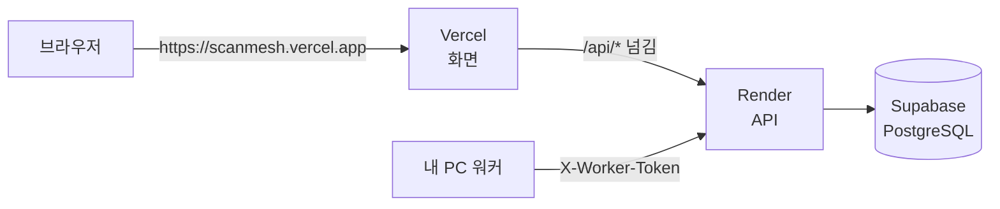

# 배포

| 구성 | 서비스 | 설정 파일 |
| --- | --- | --- |
| DB | Supabase (PostgreSQL) | - |
| API | Render 무료 웹 서비스 (Docker) | [render.yaml](../render.yaml), [api/Dockerfile](../api/Dockerfile) |
| 화면 | Vercel | [web/vercel.json](../web/vercel.json), [web/.env.production](../web/.env.production) |
| 워커 | 내 PC (점검 엔진은 Docker 컨테이너) | 환경 변수 |



화면이 API를 같은 출처의 `/api`로 부르고 Vercel이 Render로 넘깁니다. 리프레시 토큰 쿠키가 `SameSite=Strict`라서
화면과 API가 다른 사이트면 쿠키가 실리지 않기 때문입니다. 그래서 화면에는 API 주소를 넣지 않습니다(`VITE_API_URL`은 비워 둠).

서비스의 화면 구성이나 무료 플랜 조건은 바뀔 수 있으니 진행하면서 각 서비스의 안내를 함께 확인하세요.

## 1. Supabase: DB 만들기

1. 새 프로젝트를 만듭니다. 리전은 Render와 가까운 곳(예: Singapore)을 고릅니다. DB 비밀번호는 따로 저장해 둡니다.
2. 프로젝트의 **Connect** 화면에서 **Session pooler** 연결 정보를 확인합니다.
   - Render는 IPv4로만 나가는데, 직접 연결(Direct connection) 주소는 IPv6 전용이라 쓸 수 없습니다.
   - Transaction pooler(6543 포트)는 쓰지 않습니다. 연결을 요청마다 바꿔 써서 Flyway 마이그레이션과 잘 맞지 않습니다.
3. Render에 넣을 값을 만들어 둡니다.

   | 환경 변수 | 값 |
   | --- | --- |
   | `DB_URL` | `jdbc:postgresql://<풀러 호스트>:5432/postgres?sslmode=require` |
   | `DB_USERNAME` | `postgres.<프로젝트 ref>` (Session pooler의 사용자 이름) |
   | `DB_PASSWORD` | 1에서 정한 비밀번호 |

테이블은 API가 처음 뜰 때 Flyway가 만듭니다.

## 2. Render: API 올리기

1. **New → Blueprint**에서 이 저장소를 고르면 `render.yaml`대로 `scanmesh-api` 서비스가 만들어집니다.
2. 값을 물어보는 환경 변수를 넣습니다.
   - `DB_URL`, `DB_USERNAME`, `DB_PASSWORD`: 1에서 만든 값
   - `CORS_ALLOWED_ORIGINS`: 아직 화면 주소를 모르면 `https://scanmesh.vercel.app`처럼 쓸 이름으로 넣고, 3이 끝난 뒤 실제 주소로 고칩니다.
   - `JWT_SECRET`은 Render가 무작위로 만들고, `SPRING_PROFILES_ACTIVE=prod`는 이미 들어 있습니다.
3. 배포가 끝나면 `https://<서비스 주소>/api/health`가 `{"status":"ok"}`를 돌려주는지 봅니다.
4. 서비스 주소가 `https://scanmesh-api.onrender.com`이 아니면(이름이 이미 쓰이고 있으면 바뀜)
   [web/vercel.json](../web/vercel.json)의 `destination`을 실제 주소로 고쳐 커밋합니다.

운영 프로필은 다음을 강제합니다. 하나라도 어긋나면 서버가 뜨지 않거나 기능이 닫힙니다.

- `JWT_SECRET`이 없으면 뜨지 않습니다.
- `DEV_ALLOWED_HOSTS`(SSRF 방어를 건너뛰는 개발용 설정)가 있으면 뜨지 않습니다.
- 리프레시 토큰 쿠키에 `Secure`가 붙고, API 문서 화면(Swagger)은 닫힙니다.

## 3. Vercel: 화면 올리기

1. **Add New → Project**에서 이 저장소를 가져옵니다.
2. **Root Directory**를 `web`으로 정합니다. 프레임워크는 Vite로 잡히고, 빌드 명령은 `npm run build`, 결과 폴더는 `dist`입니다.
3. 환경 변수는 넣지 않습니다. `web/.env.production`이 API를 같은 출처로 부르게 합니다.
4. 배포가 끝나면 화면 주소(예: `https://scanmesh.vercel.app`)를 Render의 `CORS_ALLOWED_ORIGINS`에 넣고 Render를 다시 배포합니다.
   PR마다 생기는 미리보기 주소도 쓰려면 쉼표로 패턴을 덧붙입니다(예: `https://scanmesh-*.vercel.app`).

화면을 열어 가입, 로그인, 새로 고침(로그인 유지), 로그아웃이 되는지 봅니다.

## 4. 관리자와 워커

1. 화면에서 가입한 뒤, Supabase의 **SQL Editor**에서 관리자로 바꿉니다.

   ```sql
   update members set role = 'ADMIN' where email = '내 이메일';
   ```

2. 다시 로그인해서 받은 액세스 토큰으로 워커를 등록합니다. 토큰은 응답에서 한 번만 보입니다.

   ```bash
   curl -X POST https://scanmesh.vercel.app/api/admin/workers \
     -H "Authorization: Bearer <액세스 토큰>" -H "Content-Type: application/json" \
     -d '{"name": "my-pc-light", "kind": "LIGHT"}'
   ```

   HEAVY 워커도 같은 방법으로 등록합니다.
3. 내 PC에서 워커를 띄웁니다. API 주소는 Render 주소를 바로 씁니다(워커는 쿠키를 쓰지 않음).
   `DEV_ALLOWED_HOSTS`는 넣지 않습니다.

   ```bash
   WORKER_API_URL=https://scanmesh-api.onrender.com WORKER_TOKEN=<받은 토큰> WORKER_KIND=LIGHT ./gradlew :worker:bootRun
   ```

## 무료 플랜에서 알아 둘 점

- **Render:** 요청이 없으면 15분 뒤 잠들고, 깨어나는 데 1분쯤 걸립니다. 워커가 켜져 있으면 몇 초마다 작업을 물어봐서 잠들지 않습니다.
  무료 사용 시간은 한 달 750시간이라, 서비스 하나를 한 달 내내 켜 두는 데(약 744시간) 맞습니다. 메모리는 512MB이고,
  내 PC에서 같은 제한으로 띄웠을 때 시작 직후 약 320MB를 썼습니다.
- **Supabase:** 오랫동안(약 1주) 쓰지 않으면 프로젝트가 멈춥니다. 대시보드에서 다시 켭니다.

## 배포 전에 내 PC에서 확인하기

배포와 같은 구조(운영 프로필 API 컨테이너, 배포용 화면 빌드, `/api` 넘김)를 내 PC에서 재현합니다.

```bash
docker compose up -d
docker build -f api/Dockerfile -t scanmesh-api:local .
docker run -d --name scanmesh-api-prod --memory 512m -p 127.0.0.1:18090:10000 \
  -e PORT=10000 -e JWT_SECRET=<아무 긴 값> -e CORS_ALLOWED_ORIGINS=http://localhost:4280 \
  -e DB_URL=jdbc:postgresql://host.docker.internal:5434/scanmesh -e DB_USERNAME=scanmesh -e DB_PASSWORD=scanmesh \
  scanmesh-api:local
cd web && npm run build && SCANMESH_API_URL=http://localhost:18090 npm run preview   # http://localhost:4280
```

`npm run preview`는 Vercel처럼 `/api`를 API 컨테이너로 넘깁니다. 브라우저에서 가입, 새로 고침 뒤 로그인 유지, 로그아웃을 확인합니다.
`localhost`는 http여도 브라우저가 안전한 출처로 보므로 `Secure` 쿠키가 저장됩니다.

## 아직 남은 위험

- **엔진 컨테이너의 내부망 접근:** 워커는 대상 도메인을 검사한 IP에 고정하지만, 엔진 컨테이너의 네트워크 자체를 막지는 않습니다.
  인증한 사이트가 응답으로 내 PC의 내부망 주소를 가리키면 엔진이 따라갈 수 있습니다([design.md 6장](design.md#엔진의-ssrf-방어)).
  다른 사람에게 서비스를 열기 전에 엔진이 대상 외의 곳으로 나가지 못하게 막아야 합니다.
