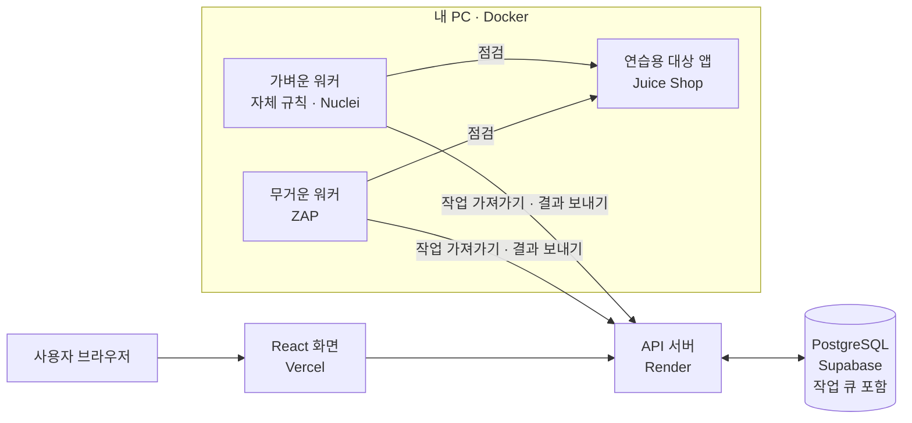
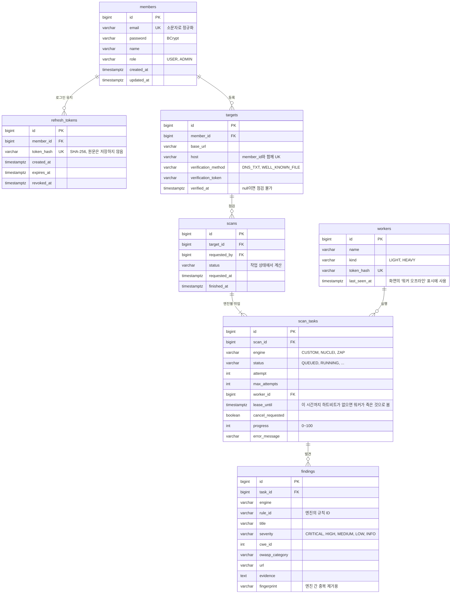
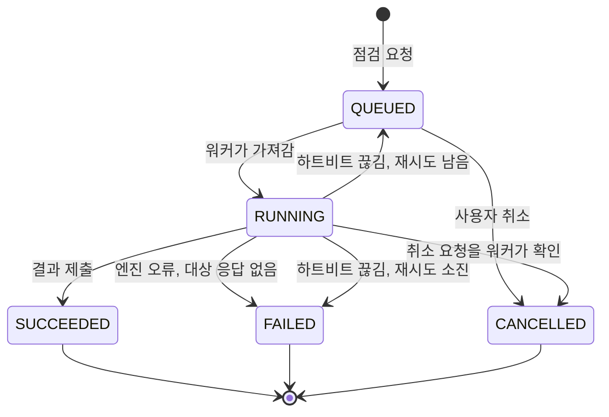

# SecuScan 설계

1주차 설계 문서입니다. 2주차 이후 기능도 미리 잡아 두고, 구현하면서 바뀌는 부분은 이 문서를 고칩니다.

## 1. 전체 구조



| 모듈 | 하는 일 |
| --- | --- |
| `common` | API와 워커가 함께 쓰는 코드: 점검 엔진 종류, 작업 상태와 상태 전이 규칙 |
| `api` | 회원, 점검 대상, 점검 요청, 작업 큐, 결과 저장. 워커가 작업을 가져가는 API도 제공 |
| `worker` | API에서 작업을 가져와 점검 엔진을 실행하고 결과를 돌려줌 |

## 2. ERD

1주차에는 `members`, `refresh_tokens`만 만들고 나머지는 해당 주차에 Flyway 마이그레이션으로 추가합니다.



## 3. 점검 상태 흐름

점검 하나(`scans`)는 엔진별 작업(`scan_tasks`)으로 나뉩니다. 가벼운 워커는 `CUSTOM`, `NUCLEI` 작업을, 무거운 워커는 `ZAP` 작업을 가져갑니다.
ZAP이 실패해도 다른 엔진의 결과는 남습니다.

### 작업 상태 (`TaskStatus`)



- 상태 전이 규칙은 `common` 모듈의 `TaskStatus`에 있고, 허용되지 않은 전이는 예외로 막습니다.
- 워커는 작업을 실행하는 동안 하트비트를 보내 `lease_until`을 늘립니다. 하트비트 응답에 취소 요청 여부가 실려 옵니다.

### 점검 상태 (`ScanStatus`)

점검 상태는 따로 바꾸지 않고 작업 상태들에서 계산합니다. 상태를 두 군데에서 따로 바꾸면 서로 어긋날 수 있기 때문입니다.

| 작업 상태들 | 점검 상태 |
| --- | --- |
| 모두 `QUEUED` | `QUEUED` |
| 하나라도 `QUEUED` 또는 `RUNNING`이고 시작된 작업이 있음 | `RUNNING` |
| 모두 `SUCCEEDED` | `COMPLETED` |
| 끝났고 일부만 `SUCCEEDED` | `PARTIAL` |
| 끝났고 `SUCCEEDED`가 없고 `FAILED`가 있음 | `FAILED` |
| 모두 `CANCELLED` | `CANCELLED` |

## 4. API

### 1주차 (구현 완료)

| 메서드 | 경로 | 설명 | 인증 |
| --- | --- | --- | --- |
| POST | `/api/auth/signup` | 회원가입 | - |
| POST | `/api/auth/login` | 로그인, 액세스·리프레시 토큰 발급 | - |
| POST | `/api/auth/refresh` | 리프레시 토큰으로 새 토큰 발급 (기존 토큰은 폐기) | - |
| POST | `/api/auth/logout` | 리프레시 토큰 폐기 | - |
| GET | `/api/members/me` | 내 정보 | 사용자 |
| GET | `/api/health` | 서버 상태 | - |

### 2주차 이후 (예정)

| 메서드 | 경로 | 설명 | 주차 |
| --- | --- | --- | --- |
| POST | `/api/targets` | 점검 대상 등록, 소유 인증 토큰 발급 | 2 |
| GET | `/api/targets` | 내 점검 대상 목록 | 2 |
| POST | `/api/targets/{id}/verify` | 소유 인증 확인 (DNS TXT 또는 파일) | 2 |
| DELETE | `/api/targets/{id}` | 점검 대상 삭제 | 2 |
| POST | `/api/targets/{id}/scans` | 점검 요청 | 3 |
| GET | `/api/scans/{id}` | 점검 상태와 진행률 | 3 |
| POST | `/api/scans/{id}/cancel` | 점검 취소 | 3 |
| GET | `/api/scans/{id}/findings` | 점검 결과 | 5 |
| POST | `/api/worker/tasks/claim` | 워커가 작업 가져가기 | 3 |
| POST | `/api/worker/tasks/{id}/heartbeat` | 하트비트, 진행률 보고, 취소 여부 확인 | 3 |
| POST | `/api/worker/tasks/{id}/complete` | 결과 제출 | 3 |
| POST | `/api/worker/tasks/{id}/fail` | 실패 보고 | 3 |

워커 API는 사용자 JWT 대신 워커 전용 토큰(`X-Worker-Token`)으로 인증합니다.

### 에러 응답

모든 에러는 같은 형식으로 응답합니다.

```json
{ "status": 409, "code": "DUPLICATE_EMAIL", "message": "이미 가입된 이메일입니다." }
```

## 5. 주요 결정

| 결정 | 이유 | 대안과 버린 이유 |
| --- | --- | --- |
| 작업 큐를 PostgreSQL로 구현 (`FOR UPDATE SKIP LOCKED`) | 점검·작업 상태와 같은 트랜잭션으로 바꿀 수 있고, 무료 인프라에 서버를 하나 덜 둠 | Redis, Kafka: 무료 플랜에서 서버가 늘고, DB와 큐 사이의 일관성을 따로 맞춰야 함 |
| 워커가 먼저 접속해 작업을 가져가는 방식 | 내 PC의 포트를 열 필요가 없고, 워커가 꺼져 있으면 작업이 큐에 쌓여 기다림 | API가 워커를 호출하는 방식: 집 PC에 외부 접속을 열어야 함 |
| 작업 임대(`lease_until`)와 하트비트 | 워커가 죽으면 임대가 끝난 작업을 다시 큐로 돌려 재시도 | 실행 중 표시만 하기: 워커가 죽으면 작업이 영원히 실행 중으로 남음 |
| 엔진별 작업 분리 | 가벼운·무거운 워커 분리, 한 엔진이 실패해도 나머지 결과는 남음 | 점검 하나를 통째로 실행: ZAP 하나가 죽으면 전부 실패 |
| 엔진별 요청 속도 제한, 대상 응답 없으면 중단 | 0주차 실험에서 제한 없는 Nuclei 점검에 Juice Shop이 메모리 부족으로 죽음 | - |
| 이메일 로그인, 액세스 토큰 30분 + 리프레시 토큰 14일 회전 | 리프레시 토큰은 쓸 때마다 바꾸고, 버린 토큰이 다시 오면 탈취로 보고 모든 로그인을 끊음 | 세션: 프론트(Vercel)와 API(Render)가 다른 도메인이라 쿠키 설정이 까다로움 |
| JWT subject에 회원 ID 사용 | 요청마다 DB를 조회하지 않고 인증, 이메일이 바뀌어도 토큰이 유효 | 이메일: 바뀔 수 있는 값 |
