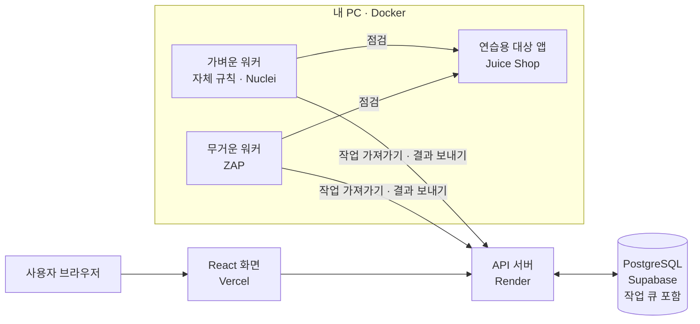
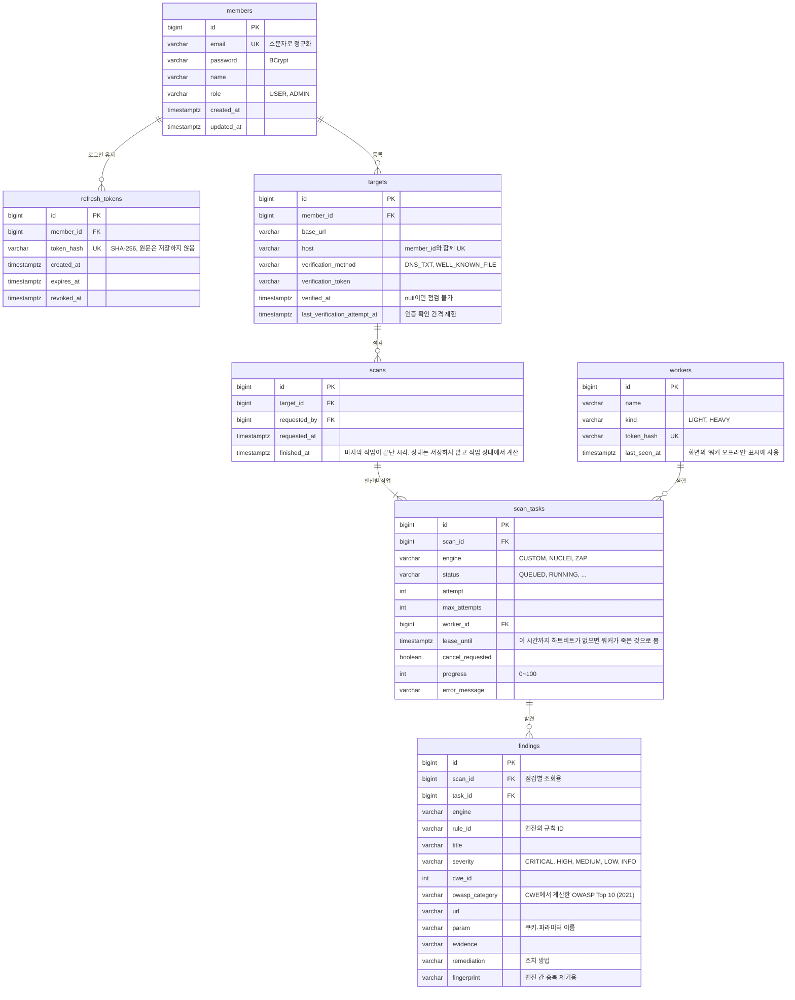
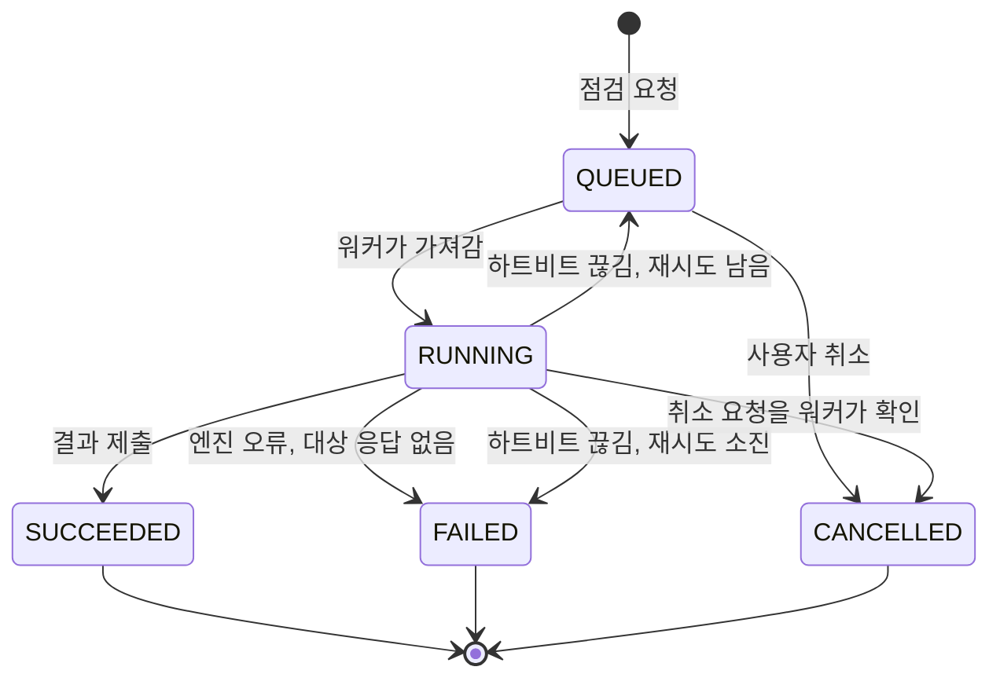

# ScanMesh 설계

1주차 설계 문서입니다. 2주차 이후 기능도 미리 잡아 두고, 구현하면서 바뀌는 부분은 이 문서를 고칩니다.

## 1. 전체 구조



| 모듈 | 하는 일 |
| --- | --- |
| `common` | API와 워커가 함께 쓰는 코드: 점검 엔진 종류, 작업 상태와 상태 전이 규칙 |
| `api` | 회원, 점검 대상, 점검 요청, 작업 큐, 결과 저장. 워커가 작업을 가져가는 API도 제공 |
| `worker` | API에서 작업을 가져와 점검 엔진을 실행하고 결과를 돌려줌 |

## 2. ERD

1주차에 `members`, `refresh_tokens`, 2주차에 `targets`, 3주차에 `scans`, `scan_tasks`, `workers`, 5주차에 `findings`를 Flyway 마이그레이션으로 만들었습니다.



## 3. 점검 상태 흐름

점검 하나(`scans`)는 엔진별 작업(`scan_tasks`)으로 나뉩니다. 가벼운 워커는 `CUSTOM`, `NUCLEI` 작업을, 무거운 워커는 `ZAP` 작업을 가져갑니다.
ZAP이 실패해도 다른 엔진의 결과는 남습니다.

### 작업 상태 (`TaskStatus`)



- 상태 전이 규칙은 `common` 모듈의 `TaskStatus`에 있고, 허용되지 않은 전이는 예외로 막습니다.
- 워커는 작업을 실행하는 동안 하트비트를 보내 `lease_until`을 늘립니다. 하트비트 응답에 취소 요청 여부가 실려 옵니다.
- 임대는 90초, 하트비트는 그 1/3인 30초마다 보냅니다. 하트비트가 한두 번 빠져도 임대가 끝나지 않습니다.
- 서버는 30초마다 임대가 끝난 작업을 찾아(`LeaseReaper`) 재시도가 남았으면 다시 큐에 넣고, 3번을 다 썼으면 실패로 끝냅니다.
- 취소 요청을 확인한 워커는 엔진을 멈추고 실패로 보고하고, 서버는 취소 요청이 있는 작업의 실패를 취소로 기록합니다.
  워커가 취소 확인 전에 죽으면 임대가 끝날 때 재시도하지 않고 취소로 끝냅니다.
- 다시 큐에 들어간 작업이 이전 워커의 늦은 보고로 바뀌지 않도록, 하트비트와 결과 보고는 지금 그 작업을 맡은 워커만 할 수 있습니다(아니면 409).

### 점검 상태 (`ScanStatus`)

점검 상태는 따로 바꾸지 않고 작업 상태들에서 계산합니다. 상태를 두 군데에서 따로 바꾸면 서로 어긋날 수 있기 때문입니다.

| 작업 상태들 | 점검 상태 |
| --- | --- |
| 모두 `QUEUED` (임대가 끝나 다시 큐에 들어간 경우 포함) | `QUEUED` |
| 모두 `QUEUED`는 아니고, 하나라도 `QUEUED` 또는 `RUNNING` | `RUNNING` |
| 모두 `SUCCEEDED` | `COMPLETED` |
| 끝났고 일부만 `SUCCEEDED` | `PARTIAL` |
| 끝났고 `SUCCEEDED`가 없고 `FAILED`가 있음 | `FAILED` |
| 모두 `CANCELLED` | `CANCELLED` |

## 4. API

### 1주차 (구현 완료)

| 메서드 | 경로 | 설명 | 인증 |
| --- | --- | --- | --- |
| POST | `/api/auth/signup` | 회원가입 | - |
| POST | `/api/auth/login` | 로그인, 액세스·리프레시 토큰 발급 | - |
| POST | `/api/auth/refresh` | 리프레시 토큰으로 새 토큰 발급 (기존 토큰은 폐기) | - |
| POST | `/api/auth/logout` | 리프레시 토큰 폐기 | - |
| GET | `/api/members/me` | 내 정보 | 사용자 |
| GET | `/api/health` | 서버 상태 | - |

### 2주차 (구현 완료)

| 메서드 | 경로 | 설명 | 인증 |
| --- | --- | --- | --- |
| POST | `/api/targets` | 점검 대상 등록, 소유 인증 토큰 발급 | 사용자 |
| GET | `/api/targets` | 내 점검 대상 목록 | 사용자 |
| POST | `/api/targets/{id}/verify` | 소유 인증 확인. 실패해도 200으로 `verified: false`와 고칠 점을 돌려줌. 10초에 한 번 | 사용자 |
| DELETE | `/api/targets/{id}` | 점검 대상 삭제 | 사용자 |

다른 회원의 대상은 403 대신 404로 응답해서 대상 ID가 있는지 알 수 없게 합니다.

### 3주차 (구현 완료)

| 메서드 | 경로 | 설명 | 인증 |
| --- | --- | --- | --- |
| POST | `/api/targets/{id}/scans` | 점검 요청. 인증된 대상만, 대상마다 끝나지 않은 점검은 하나만. 본문 `{"engines": [...]}`을 비우면 모든 엔진 | 사용자 |
| GET | `/api/targets/{id}/scans` | 대상의 최근 점검 20개 | 사용자 |
| GET | `/api/scans/{id}` | 점검 상태, 진행률, 엔진별 작업 상태 | 사용자 |
| POST | `/api/scans/{id}/cancel` | 점검 취소. 대기 중인 작업은 바로, 실행 중인 작업은 워커가 확인한 뒤 취소 | 사용자 |
| POST | `/api/worker/tasks/claim` | 작업 가져가기. 워커 종류에 맞는 엔진만, 없으면 204 | 워커 |
| POST | `/api/worker/tasks/{id}/heartbeat` | 하트비트, 진행률 보고, 취소 여부 확인 | 워커 |
| POST | `/api/worker/tasks/{id}/complete` | 완료 보고. 본문 `{"findings": [...]}`에 발견 항목을 500개까지 함께 보냄 | 워커 |
| POST | `/api/worker/tasks/{id}/fail` | 실패 보고 | 워커 |
| POST | `/api/admin/workers` | 워커 등록, 워커 토큰 발급 (토큰은 이때 한 번만 보여 줌) | 관리자 |
| GET | `/api/admin/workers` | 워커 목록과 온라인 여부 (1분 안에 요청이 있었으면 온라인) | 관리자 |

워커 API는 사용자 JWT 대신 워커 전용 토큰(`X-Worker-Token`)으로 인증합니다. 사용자 JWT로는 워커 API를 쓸 수 없습니다.

### 5주차 (구현 완료)

| 메서드 | 경로 | 설명 | 인증 |
| --- | --- | --- | --- |
| GET | `/api/scans/{id}/findings` | 점검 결과. 같은 검사는 문제 하나로 접고 위치(URL) 목록을 담음. 위험도 순, 위험도별 문제 수와 함께. 점검 중이면 끝난 엔진의 결과만 | 사용자 |

### 에러 응답

모든 에러는 같은 형식으로 응답합니다.

```json
{ "status": 409, "code": "DUPLICATE_EMAIL", "message": "이미 가입된 이메일입니다." }
```

## 5. 점검 대상과 SSRF 방어

점검 서비스는 사용자가 입력한 주소로 서버가 직접 요청을 보내므로, 그 주소가 내부망을 가리키면
우리 서버를 통해 바깥에서 보이지 않는 곳(DB, 클라우드 메타데이터 `169.254.169.254` 등)을 건드릴 수 있습니다(SSRF).

### 소유 인증

| 방법 | 사용자가 할 일 |
| --- | --- |
| `DNS_TXT` | `_scanmesh-verification.{host}`에 TXT 레코드로 인증 토큰을 추가 |
| `WELL_KNOWN_FILE` | `{origin}/.well-known/scanmesh-verification.txt`에 인증 토큰 한 줄을 올림 |

인증하지 않은 대상은 점검을 요청할 수 없습니다(3주차에 적용).

### 검사 단계

| 단계 | 검사 | 위치 |
| --- | --- | --- |
| 등록 | http/https만, 도메인만(IP 주소 불가), 아이디·비밀번호(@) 불가, `localhost`·`.internal`·`.local` 같은 내부용 이름 불가 | `TargetUrl` |
| 등록 | DNS로 찾은 주소가 하나라도 내부망·예약 주소면 거부 | `TargetService` |
| 인증 파일 요청 | 연결 직전에 다시 DNS를 조회해 검사하고, 검사한 주소로 그대로 연결 (DNS 리바인딩 방어) | `SafeHttpClient` |
| 인증 파일 요청 | 리다이렉트는 같은 호스트 안에서 3번까지, 전체 5초, 본문 4KB까지, 프록시 사용 안 함 | `SafeHttpClient` |
| 점검 | 워커가 점검 시작 직전에 DNS를 다시 조회해 같은 규칙으로 검사. 내부 주소면 실패로 보고 | 워커의 `TargetGuard` |

막는 주소 범위(사설망, 루프백, 링크 로컬, 통신사 NAT, 멀티캐스트, 문서용, IPv6 ULA·NAT64·6to4, IPv4 매핑 주소 등)는
`PublicAddressPolicy`에 있고, API와 워커가 함께 쓰도록 `common` 모듈에 둡니다.

### 개발용 허용 호스트

Juice Shop 같은 연습용 대상은 `localhost`나 Docker 서비스 이름(`juice-shop`)이라 위 검사를 통과할 수 없고,
DNS나 인증 파일로 소유를 증명할 수도 없습니다. 그래서 `DEV_ALLOWED_HOSTS`에 적은 호스트는
주소 검사를 건너뛰고 등록하자마자 인증된 것으로 봅니다. API와 워커에 같은 값을 넣습니다.

- 기본값은 비어 있습니다.
- 운영 서버가 내부망을 점검하지 않도록, 배포(prod 프로필)에서 값이 있으면 API 서버가 뜨지 않습니다(`DevAllowedHosts`).

## 6. 점검 엔진

| 엔진 | 실행 방식 | 하는 일 | 원본 결과 파일 |
| --- | --- | --- | --- |
| `CUSTOM` | 워커 안에서 직접 | 보안 헤더, 쿠키 속성, 인증서 오류·만료, 민감 파일 노출 | 없음 |
| `NUCLEI` | Docker 컨테이너 | 알려진 CVE와 설정 실수. `-as -rl 50 -c 10`, `dos,fuzz,intrusive,bruteforce` 태그 제외 | `nuclei.jsonl` |
| `ZAP` | Docker 컨테이너 | baseline(수동 점검): 사이트를 둘러보며 응답만 살피고 공격 요청은 보내지 않음 | `zap.json` |

- 원본 결과 파일은 확인용으로 `worker-results/scan-{점검 ID}/{엔진}-task-{작업 ID}-attempt-{시도}/`에 남습니다. 워커가 시작할 때와 작업이 끝날 때마다, 가장 최근 파일도 7일이 지난 점검 폴더를 지웁니다.
- 민감 파일은 SPA가 없는 주소에도 200으로 첫 화면을 돌려주므로 응답 코드만 보지 않고 내용까지 맞아야 발견으로 칩니다. 파일 내용과 쿠키 값은 결과에 옮기지 않습니다.
- 컨테이너는 취소, 제한 시간 초과, 대상 무응답 때 `docker rm -f`로 지웁니다. `docker run` 프로세스만 끝내면 컨테이너는 계속 돌기 때문입니다.
- 점검 중 15초마다 대상을 확인해 4번 연달아 응답이 없으면(연결 실패, 502·503·504) 점검을 멈추고 실패로 끝냅니다.
- 엔진이 진행률을 알려 주지 않으므로 Nuclei와 ZAP의 진행률은 예상 시간 기준 어림값이고, 끝나기 전에는 95%를 넘지 않습니다.

### 엔진의 SSRF 방어

| 경로 | 방어 |
| --- | --- |
| 자체 규칙 | 검사한 IP로만, 대상 호스트로만 연결 (`PinnedHttpFetcher`). 다른 호스트로의 리다이렉트는 따라가지 않음 |
| Nuclei, ZAP | `--add-host`로 대상 도메인을 검사한 IP에 고정해서 엔진이 DNS를 다시 조회하지 않게 함 |

**남은 한계:** 고정되는 것은 대상 도메인 이름뿐입니다. 컨테이너의 네트워크 자체를 막지는 않으므로, 대상 사이트가 응답으로 내부 주소를 가리킬 때
엔진이 따라가는 것까지 네트워크 수준에서 차단하지는 못합니다. 배포 전에 엔진 컨테이너의 내부망 접근을 막는 네트워크 구성이 필요합니다.

## 7. 결과 통합

엔진마다 다른 결과를 워커에서 `common`의 공통 형식(`Finding`)으로 바꿔 작업 완료 보고에 실어 보냅니다.

| 엔진 | 규칙 ID | 위험도 | CWE | 조치 방법 |
| --- | --- | --- | --- | --- |
| `CUSTOM` | 자체 규칙 ID | 규칙에 정해 둠 | 규칙에 정해 둠 | 한국어로 직접 씀 |
| `NUCLEI` | `템플릿 ID:매처 이름` | `info.severity` | `classification.cwe-id` | `info.remediation` (없으면 비움) |
| `ZAP` | `alertRef` (같은 플러그인의 변형 구분) | `riskcode` 3·2·1·0 → HIGH·MEDIUM·LOW·INFO | `cweid` (-1은 비움) | `solution`의 HTML 태그를 뗀 값 |

- ZAP은 경고 하나에 URL이 여러 개 달려 있어서, 다른 엔진과 페이지 단위로 묶이도록 URL마다 항목 하나로 나눕니다. 경고 하나에서 20개까지만 남깁니다.
- 작업 하나에서 500개까지 받고, 넘으면 워커가 위험도가 높은 것부터 남깁니다. 너무 긴 값은 버리지 않고 저장할 때 자릅니다.
- 결과 저장과 작업 완료는 같은 트랜잭션입니다. 재시도한 작업이 결과를 두 번 남기지 않고, 임대를 잃은 워커의 결과는 저장되지 않습니다.

### 중복 묶기와 접기

엔진 간 중복은 저장할 때 지우지 않고 보여 줄 때 두 단계로 묶습니다. 어느 엔진이 무엇을 찾았는지 남기기 위해서입니다.

1. **위치:** 지문(`fingerprint`)이 같으면 같은 페이지의 같은 문제로 보고 하나로 묶습니다.
2. **문제:** 검사 종류가 같으면 여러 페이지를 문제 하나로 접고 위치 목록에 담습니다. ZAP은 같은 경고를 페이지마다 따로 내기 때문입니다.

- 지문 = SHA-256(검사 종류 + 정규화한 URL + 위치 이름). URL은 스킴·호스트를 소문자로, 기본 포트·쿼리·조각을 빼서 맞춥니다.
- 위치 이름은 쿠키 검사에서만 씁니다(쿠키 이름). 보안 헤더 검사는 엔진마다 적는 방식이 달라서(ZAP은 빠진 헤더 이름을 적고 자체 규칙은 비워 둠) 쓰지 않습니다.
- 검사 종류는 엔진이 함께 하는 검사(CSP, HSTS, X-Content-Type-Options, 클릭재킹 방어, 버전 노출, 쿠키 속성)를 같은 이름으로 맞춘 표(`FindingFingerprint`)로 정하고, 표에 없으면 `엔진:규칙 ID`를 그대로 씁니다. 버전 노출은 헤더(Server, X-Powered-By)별로 나눕니다.
- ZAP 규칙 ID는 보안 헤더 없이 버전을 드러내고 속성 없는 쿠키를 주는 시험 페이지를 ZAP 2.17로 점검해서 확인했고, 그 보고서를 테스트 예제로 둡니다(`worker/src/test/resources/zap/header-less-site.json`).
  https에서만 나오는 HSTS(`10035-1`)와 쿠키 Secure(`10011`), 그리고 Nuclei의 매처 이름은 실제 결과로 확인하지 못했습니다. 맞지 않으면 묶이지 않고 따로 보일 뿐 결과가 사라지지는 않습니다.
- 묶은 항목의 위험도는 가장 높은 값, 제목과 조치 방법은 자체 규칙 → ZAP → Nuclei 순으로 고릅니다.

### OWASP Top 10 분류

- 기본은 CWE 번호를 OWASP가 분류마다 공개한 CWE 목록(2021)에 맞춰 바꿉니다.
- **보충 규칙:** 보안 헤더가 없거나 잘못된 문제는 A05(보안 설정 오류)로 봅니다. A05 설명이 "보안 헤더를 보내지 않거나 안전한 값으로 설정하지 않음"을 직접 예로 들지만,
  엔진들이 붙이는 CWE-693은 공식 목록에 없기 때문입니다. HSTS는 공식 표로는 CWE-319라 A02지만 헤더 설정 문제이므로 같이 A05로 봅니다.
- 어느 쪽에도 없으면(예: ZAP의 캐시 관련 정보성 항목) 분류하지 않습니다.

4주차와 같은 Juice Shop 점검 결과는 15개 문제(위치 47곳)로 접혔습니다. 첫 화면의 CSP 누락은 자체 규칙과 ZAP이 함께 찾아 한 위치로 묶였습니다.

## 8. 주요 결정

| 결정 | 이유 | 대안과 버린 이유 |
| --- | --- | --- |
| 작업 큐를 PostgreSQL로 구현 (`FOR UPDATE SKIP LOCKED`) | 점검·작업 상태와 같은 트랜잭션으로 바꿀 수 있고, 무료 인프라에 서버를 하나 덜 둠 | Redis, Kafka: 무료 플랜에서 서버가 늘고, DB와 큐 사이의 일관성을 따로 맞춰야 함 |
| 워커가 먼저 접속해 작업을 가져가는 방식 | 내 PC의 포트를 열 필요가 없고, 워커가 꺼져 있으면 작업이 큐에 쌓여 기다림 | API가 워커를 호출하는 방식: 집 PC에 외부 접속을 열어야 함 |
| 작업 임대(`lease_until`)와 하트비트 | 워커가 죽으면 임대가 끝난 작업을 다시 큐로 돌려 재시도 | 실행 중 표시만 하기: 워커가 죽으면 작업이 영원히 실행 중으로 남음 |
| 엔진별 작업 분리 | 가벼운·무거운 워커 분리, 한 엔진이 실패해도 나머지 결과는 남음 | 점검 하나를 통째로 실행: ZAP 하나가 죽으면 전부 실패 |
| 엔진별 요청 속도 제한, 대상 응답 없으면 중단 | 0주차 실험에서 제한 없는 Nuclei 점검에 Juice Shop이 메모리 부족으로 죽음 | - |
| 이메일 로그인, 액세스 토큰 30분 + 리프레시 토큰 14일 회전 | 리프레시 토큰은 쓸 때마다 바꾸고, 버린 토큰이 다시 오면 탈취로 보고 모든 로그인을 끊음 | 세션: 프론트(Vercel)와 API(Render)가 다른 도메인이라 쿠키 설정이 까다로움 |
| 검사한 IP로 그대로 연결하는 HTTP 클라이언트 (Apache HttpClient의 DNS 조회 단계에서 검사) | 검사할 때와 연결할 때 DNS를 따로 조회하면 그 사이에 응답을 내부 주소로 바꿀 수 있음 | 요청 전에 `InetAddress`로 한 번 검사: DNS 리바인딩에 뚫림. JDK `HttpClient`: DNS 조회를 바꿔 끼울 수 없음 |
| 대상마다 끝나지 않은 점검은 하나만, 점검 요청 때 대상 행을 잠금 | 같은 사이트를 여러 엔진이 겹쳐 점검하면 0주차처럼 대상 앱이 죽을 수 있음. 잠그지 않으면 동시에 요청할 때 둘 다 통과함 | - |
| 워커는 작업을 한 번에 하나씩 실행 | 엔진 하나가 1GB 가까이 쓰므로 내 PC에서 동시에 여러 개를 돌리지 않음. 더 돌리려면 워커를 늘림 | 워커 안에서 동시 실행: 메모리 관리가 어려움 |
| 워커는 내 PC에서 직접 실행하고 엔진만 컨테이너로 띄움 | 워커까지 컨테이너에 넣으면 Docker 소켓을 넘겨야 하고, 그러면 워커가 내 PC의 Docker 전체를 제어할 수 있게 됨 | 워커도 컨테이너로: Docker 소켓 노출 |
| 발견 항목을 작업 완료 보고에 함께 실음 | 결과 저장과 작업 완료가 한 트랜잭션이라, 결과만 남고 작업은 실패하거나 재시도가 결과를 두 번 남기는 일이 없음 | 결과를 따로 올리는 API: 완료와 결과 사이가 어긋날 수 있음 |
| 결과 API에서 같은 검사를 문제 하나로 접음 | 화면마다 접는 규칙을 다시 만들지 않고, 위험도별 개수도 문제 단위로 셀 수 있음 | 위치 목록만 주고 화면에서 접기: 개수와 정렬 기준이 화면마다 달라질 수 있음 |
| 중복은 저장할 때가 아니라 보여 줄 때 묶음 | 엔진별로 무엇을 찾았는지 남고, 묶는 규칙을 바꿔도 지난 점검에 바로 반영됨 | 저장할 때 합치기: 규칙을 바꾸면 지난 결과를 다시 만들 수 없음 |
| 인증 확인 간격 제한을 조건부 UPDATE 한 문장으로 | 동시에 눌러도 한 번만 통과하고, 외부 요청을 기다리는 동안 행을 잠그지 않음 | `SELECT ... FOR UPDATE`: 최대 5초 걸리는 외부 요청 동안 DB 연결과 잠금을 붙잡음 |
| JWT subject에 회원 ID 사용 | 요청마다 DB를 조회하지 않고 인증, 이메일이 바뀌어도 토큰이 유효 | 이메일: 바뀔 수 있는 값 |
